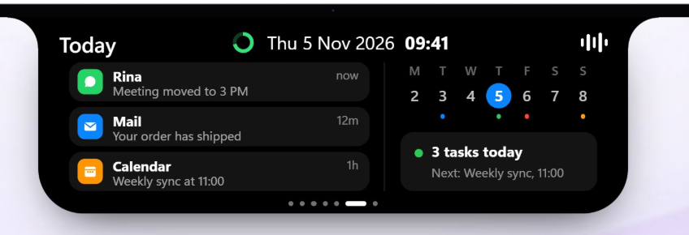
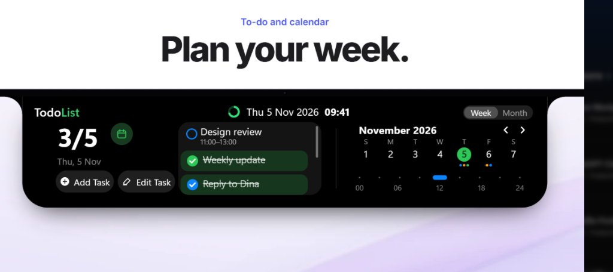
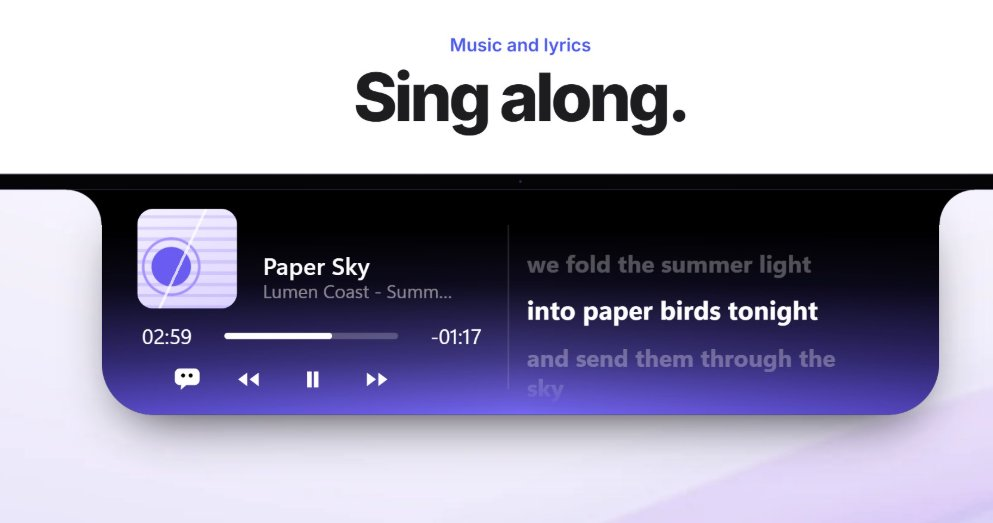
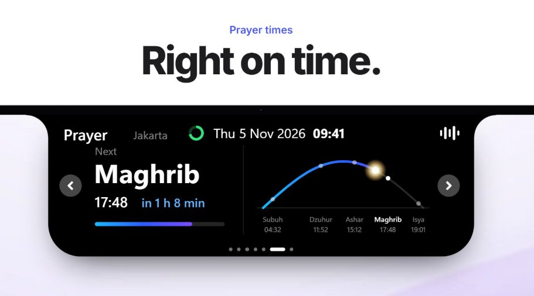
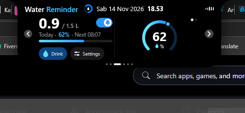

# 🗺️ Roadmap & Spesifikasi Fitur Masa Depan (Dynamic Island)

Dokumen ini merangkum rancangan fitur-fitur baru (*feature plans*) untuk **Dynamic Island (Native Windows - Rust)** berdasarkan konsep visual interaktif ala *Nusa Shelf*. Semua modul dirancang menggunakan **Pure Rust**, **Direct2D Hardware-Accelerated Rendering**, dan **Win32 API** tanpa dependensi runtime berat.

---

## 📑 Daftar Isi
1. [Arsitektur Inti: Carousel & Shelf System](#1-arsitektur-inti-carousel--shelf-system)
2. [Modul 1: Today Dashboard (Daily Briefing)](#2-modul-1-today-dashboard-daily-briefing)
3. [Modul 2: TodoList & Weekly Planner](#3-modul-2-todolist--weekly-planner)
4. [Modul 3: Music & Synced Lyrics (Sing Along)](#4-modul-3-music--synced-lyrics-sing-along)
5. [Modul 4: Prayer Times (Jadwal Sholat & Sun Arc)](#5-modul-4-prayer-times-jadwal-sholat--sun-arc)
6. [Modul 5: Water Reminder (Hydration Tracker)](#6-modul-5-water-reminder-hydration-tracker)
7. [Fase Implementasi (Milestones)](#7-fase-implementasi-milestones)

---

## 1. Arsitektur Inti: Carousel & Shelf System

Setiap kartu fitur berbagi tata letak (*layout container*) terpadu dengan dimensi standar:
* **Dimensi**: Lebar `520px – 560px`, Tinggi `136px – 144px`, Radius Sudut `26px`.
* **Top Status Bar**: 
  * Kiri: Judul Modul (misal: `Today`, `TodoList`, `Prayer`, `Water Reminder`).
  * Tengah: Battery Ring Indicator + Tanggal & Jam lokal (`Sab 14 Nov 2026 18:54`).
  * Kanan: Live Audio Visualizer bars (animasi aktif jika ada musik yang diputar).
* **Navigasi Carousel**:
  * Tombol panah samping `[ < ]` dan `[ > ]` untuk berpindah kartu.
  * Indikator pagination di bagian bawah: `• • — • • •` (kartu aktif berbentuk kapsul panjang `—`).
  * Mendukung gestur *Horizontal Mouse Scroll* dan swipe.

```
┌─────────────────────────────────────────────────────────────────────────────┐
│ Today                    ⭕ Sab 14 Nov 2026 18:54                      ılılı │
├──────────────────────────────────────┬──────────────────────────────────────┤
│                                      │                                      │
│           KONTEN KIRI                │            KONTEN KANAN              │
│       (Data / Ringkasan)             │         (Widget / Visualisasi)       │
│                                      │                                      │
├──────────────────────────────────────┴──────────────────────────────────────┤
│                                • • — • • •                                  │
└─────────────────────────────────────────────────────────────────────────────┘
```

---

## 2. Modul 1: Today Dashboard (Daily Briefing)

> Ringkasan harian cerdas: notifikasi masuk terbaru dan kalender mingguan dalam satu pandangan.



### Komponen Visual:
* **Sisi Kiri (Recent Notifications Shelf)**:
  * Menampilkan 3 antrean notifikasi terakhir secara rapi.
  * Ikon aplikasi (WhatsApp, Mail, Calendar, Windows System).
  * Judul pengirim/aplikasi, cuplikan pesan singkat, dan *relative time* (`now`, `12m`, `1h`).
  * Klik pada notifikasi langsung membuka aplikasi pengirim.
* **Sisi Kanan (Mini Calendar & Task Status)**:
  * Baris hari dalam seminggu: `M  T  W  T  F  S  S`.
  * Angka tanggal: `2  3  4  5  6  7  8` dengan highlight lingkaran biru pada hari ini.
  * Dot warna-warni di bawah tanggal (penanda kategori jadwal: biru = meeting, hijau = tugas, merah = deadline).
  * Kotak ringkasan tugas: `"3 tasks today • Next: Weekly sync, 11:00"`.

### Data Flow & Sumber Data:
* **Notifikasi**: Dari internal `NotificationListener` (WinRT `UserNotificationListener`).
* **Kalender**: Sinkronisasi lokal via file `calendar.json` atau Windows Calendar API.

---

## 3. Modul 2: TodoList & Weekly Planner

> Manajemen tugas cepat tanpa perlu membuka aplikasi to-do eksternal.



### Komponen Visual:
* **Sisi Kiri**:
  * Indikator progres: `3/5` (besar) dengan ikon kalender hijau.
  * Sub-label hari/tanggal (`Thu, 5 Nov`).
  * Tombol aksi: `[+ Add Task]` dan `[✎ Edit Task]` dengan rounded pill styling.
* **Sisi Tengah (Interactive Task List)**:
  * Daftar tugas dengan kotak centang interaktif (bisa diklik langsung):
    * Lingkaran kosong (belum selesai): `Design review 11:00–13:00`.
    * Centang hijau (selesai): `Weekly update`.
    * Centang biru: `Reply to Dina`.
* **Sisi Kanan (Calendar & Timeline Bar)**:
  * Toggle tab: `[Week | Month]`.
  * Navigasi bulan `< November 2026 >`.
  * Baris timeline 24-jam di bagian bawah (`00  06  12  18  24`) dengan blok biru penanda durasi event aktif.

### Penyimpanan Data:
* Format lokal ringan: `tasks.json` di `%LOCALAPPDATA%/DynamicIsland/tasks.json`.

---

## 4. Modul 3: Music & Synced Lyrics (Sing Along)

> Tampilan pemutar musik lengkap dengan lirik karaoke real-time yang tersinkronisasi.



### Komponen Visual:
* **Background Gradient**: Gradien dinamis yang diekstrak secara otomatis dari palet warna cover album yang sedang diputar.
* **Sisi Kiri (Media Controller)**:
  * Cover album berukuran `48x48px` rounded square.
  * Judul lagu & nama artis dengan auto-scroll marquee jika teks panjang.
  * Elapsed & remaining time (`02:59` / `-01:17`).
  * Interactive seek progress slider dengan draggable thumb knob.
  * Tombol kontrol: Speech bubble `[💬]` (toggle lirik), `[⏮]`, `[⏯]`, `[⏭]`.
* **Sisi Kanan (Synced Real-time Lyrics)**:
  * Tiga baris lirik bergulir otomatis:
    * Baris sebelumnya (redup, opacity 40%).
    * **Baris aktif saat ini** (tebal, putih menyala, font lebih besar).
    * Baris berikutnya (redup, opacity 40%).
  * Transisi teks halus menggunakan Direct2D text formatting & spring physics.

### Sumber Lirik (Lyrics Engine):
1. **LRCLIB API** (`https://lrclib.net/api/get`): Layanan lirik sinkronisasi terbuka gratis tanpa registrasi API key.
2. **Netease / Musixmatch Cache**: Fallback jika lirik tidak ditemukan di LRCLIB.
3. **Format Sinkronisasi**: Mendukung format standar LRC `[mm:ss.xx] Lyric text`.

---

## 5. Modul 4: Prayer Times (Jadwal Sholat & Sun Arc)

> Pengingat jadwal sholat 5 waktu dengan visualisasi lintasan matahari astronomis yang akurat.



### Komponen Visual:
* **Sisi Kiri (Next Prayer Countdown)**:
  * Lokasi kota: misal `Jakarta`.
  * Sholat berikutnya: misal `Maghrib 17:48`.
  * Hitung mundur real-time: `in 1 h 8 min`.
  * Progress bar linier gradien biru-ungu yang terisi sesuai sisa waktu menuju adzan.
* **Sisi Kanan (Celestial Sun Arc Curve)**:
  * Kurva parabola Bézier mulus yang menggambarkan lintasan matahari dari ufuk timur ke barat.
  * Titik penanda sholat sepanjang kurva: `Subuh (04:32)`, `Dzuhur (11:52)`, `Ashar (15:12)`, `Maghrib (17:48)`, `Isya (19:01)`.
  * **Bola Matahari Bercahaya (Glowing Sun Orb)**: Bergerak secara real-time di atas kurva sesuai posisi sudut elevasi matahari saat ini.

### Algoritma Perhitungan:
* Menggunakan algoritma astronomis standar (Kemenag RI / Muslim World League / Egyptian General Authority).
* Input koordinat Latitude & Longitude (bisa disetel di `config.txt` atau auto-detect IP Geolocation).

---

## 6. Modul 5: Water Reminder (Hydration Tracker)

> Pengingat minum air harian untuk menjaga kesehatan dan fokus saat bekerja di depan PC.



### Komponen Visual:
* **Sisi Kiri (Intake & Quick Controls)**:
  * Progres volume: misal `0.9 / 1.5 L` (angka besar).
  * Status persentase & jadwal berikutnya: `Today 62% • Next 08:07`.
  * Horizontal progress bar dengan warna air (*cyan/azure*).
  * Toggle switch aktivasi pengingat suara/notifikasi (dengan ikon lonceng).
  * Tombol aksi cepat:
    * `[💧 Drink]`: Menambah 250ml dalam 1 klik.
    * `[⚙ Settings]`: Mengatur target harian (misal: 2.0L) dan interval pengingat (misal: per 45 menit).
* **Sisi Kanan (Circular Gauge)**:
  * Circular progress ring arc dengan persentase `62%` dan ikon tetesan air `💧`.
  * Animasi pengisian cincin mulus menggunakan Direct2D arc geometries.

---

## 7. Fase Implementasi (Milestones)

| Fase | Modul | Deskripsi Pekerjaan |
|---|---|---|
| **Fase 1** | **Carousel & Pagination Framework** | Membuat container shelf di `renderer.rs` & `island.rs`: animasi transisi antar halaman (slide/fade), navigasi panah `<` `>`, dan indikator titik bawah. |
| **Fase 2** | **Sing Along (Synced Lyrics)** | Integrasi HTTP client ringan ke LRCLIB, parsing format `.lrc`, dan rendering 3 baris lirik sinkron di panel kanan kartu musik. |
| **Fase 3** | **Water Reminder** | Sistem pelacakan hidrasi lokal, timer interval berkala, circular arc meter Direct2D, dan persistensi harian. |
| **Fase 4** | **Prayer Times & Sun Arc** | Kalkulator waktu sholat astronomis lokal (pure Rust math tanpa dependensi online), kurva lintasan matahari Bézier Direct2D. |
| **Fase 5** | **TodoList & Today Dashboard** | Integrasi kalender lokal, checklist interaktif, dan aggregation antrean notifikasi Windows. |

---

> 💡 *File ini disimpan sebagai acuan desain & arsitektur kapan pun fitur-fitur di atas siap dikembangkan.*
